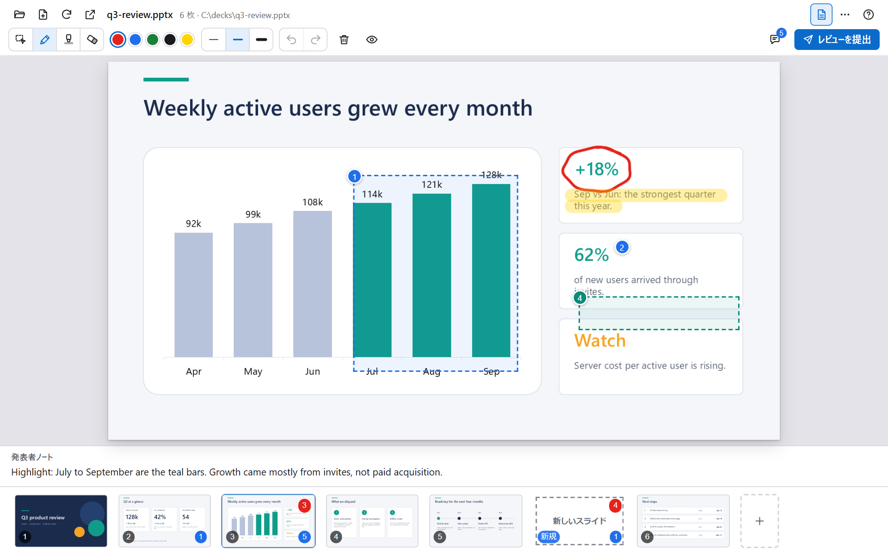
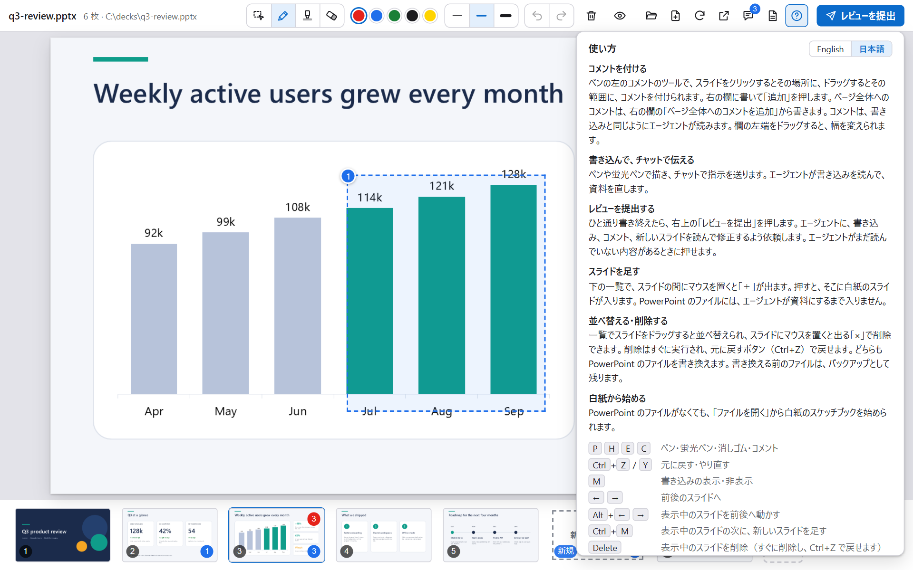

<div align="center">

# Copilot PPTX Review Canvas

**スライドに書き込んで、Copilot のエージェントに直してもらう。**

PowerPoint のレビューを会話に変える [GitHub Copilot のキャンバス](https://code.visualstudio.com/docs/agents/run/canvases)です。間違いを丸で囲み、コメントを付け、足りないスライドをスケッチします。エージェントには、どこを指したのか、ペンの下にどの図形があったのかまで伝わります。

[](./LICENSE)
[](#動作環境)
[](#動作環境)
[](https://code.visualstudio.com/docs/agents/run/canvases)

[English](./README.md) | 日本語


</div>

## なぜ作ったか

資料へのフィードバックをチャットで伝えるには、場所を言葉にする必要があります。「5 ページ目の 3 つ目の箇条書きを短くして」のような指示は時間がかかり、エージェントも意図を推測するしかありません。

このキャンバスでは、言葉の代わりに指し示します。エージェントには次の情報が届きます。

- 書き込みと、番号付きのコメントが入ったスライドの画像
- 書き込みとコメントそれぞれの内容と、スライド上の位置
- 書き込みの下にある図形の名前。資料をスクリプトで作っている場合は、スクリプトやテンプレートの該当箇所を探す手がかりになります。

エージェントが資料を直すと、キャンバスがファイルを自動で描き直します。そのまま続けてレビューできます。

## 機能

| | |
|:--|:--|
| **スライドに書き込む** | ペン、蛍光ペン、消しゴム。色は 5 色、太さは 3 段階。元に戻す・やり直すにも対応します。書き込みはスライドごとに保存され、スライドの見た目が変わらない限り残ります。 |
| **PowerPoint のようにコメントする** | スライドをクリックして位置に、ドラッグして範囲に、またはスライド全体にコメントを付けられます。印には番号が付き、同じ番号がエージェントにも渡ります。 |
| **新しいスライドをスケッチする** | スライドとスライドの間に白紙のスライドを足し、レイアウトを描きます。エージェントが資料にするまで、ビューアの中にだけ存在します。資料がまだなくても、スケッチブックから始められます。 |
| **並べ替えと削除** | 一覧でドラッグして並べ替え、またはスライドを削除できます。ファイルのバックアップを取り、元に戻すこともできます。書き換えるのは .pptx の中のスライドの並びだけで、PowerPoint で保存し直すことはありません。 |
| **エージェント向けの操作** | 資料を開く、スライドへ移動する、構成・ノート・書き込みを読む、描き直す、などの操作を備えています。未読の書き込みがあるときは、エージェントに知らせます。 |
| **ローカルで完結** | 描画はお使いの PowerPoint で行います。データはすべてお使いの PC に残り、テレメトリーも外部のアセットもありません。 |
| **英語と日本語** | ヘルプの画面で切り替えられます。 |

<table>
  <tr>
    <td width="50%"><br><sub><b>コメント</b>: 位置、範囲、スライド全体。</sub></td>
    <td width="50%"><br><sub><b>新しいスライド</b>: 案を描けば、エージェントが作ります。</sub></td>
  </tr>
  <tr>
    <td width="50%"><br><sub><b>並べ替え</b>: 一覧でドラッグし、線の位置で離します。</sub></td>
    <td width="50%"><br><sub><b>ノート</b>: レビューしながら発表者ノートを読めます。</sub></td>
  </tr>
</table>

## 仕組み


- 書き込みはスライドに対する割合（0 から 1）で保存するため、ウィンドウの大きさが変わっても位置はずれません。
- エージェントが新しい版を保存すると、見た目が変わっていないスライドの書き込みは残ります。変わったスライドの書き込みは退避され、古い指摘が新しい内容を指すことはありません。
- 次のメッセージを送るとき、まだ読まれていない書き込みがあるスライドをキャンバスがエージェントに伝えます。
- キャンバスはスライドの内容を編集しません。編集はエージェントが、python-pptx、ビルドスクリプト、PowerPoint の自動操作など、それぞれの道具で行います。

## 動作環境

- Windows 10 または 11
- Microsoft PowerPoint（デスクトップ版）。描画に PowerPoint を使うため、Web 版と Mac 版は対象外です。
- キャンバスに対応した Copilot のクライアント。キャンバスはプレビュー機能です。VS Code では `chat.canvases.enabled` を有効にし、Copilot ハーネスで新しいセッションを始めてください。詳しくは [Use canvases with agents](https://code.visualstudio.com/docs/agents/run/canvases)（英語）を参照してください。

## インストール

Copilot CLI では、このリポジトリをマーケットプレイスとして追加し、そこからプラグインをインストールします。

```powershell
copilot plugin marketplace add openjny/copilot-pptx-review-canvas
copilot plugin install copilot-pptx-review-canvas@copilot-pptx-review-canvas
```

VS Code では、このリポジトリをマーケットプレイスとして追加し、そこからプラグインをインストールします。コマンドパレットで **Chat: Open Customizations** を実行し、**Browse** を選び、ソースのメニューから **Configure Marketplaces**、**Add Marketplace** の順に選んで `openjny/copilot-pptx-review-canvas` を入力します。**Browse** に戻り、ソースのメニューでこのマーケットプレイスを選んで、プラグインの **Install** を押します。

インストールのあとは、新しいセッションを始めてください。キャンバスは、インストールのあとに始めたセッションにだけ表示されます。更新するには `copilot plugin update copilot-pptx-review-canvas@copilot-pptx-review-canvas` を実行します。

> [!NOTE]
> キャンバスの ID は `pptx-review-canvas` です。同じプラグインを複数の方法でインストールすると、キャンバスが二重に登録されます。インストールは 1 つの方法だけにしてください。

> [!NOTE]
> 拡張機能は、メッセージを送るときに動くフックを 1 つ登録します。エージェントがまだ読んでいない書き込みがあるときに、そのことを伝える短い非表示のメモを足すためのものです。フックは特権のある機能なので、初めて使うときに Copilot のクライアントから拡張機能の承認を求められます。フックの実装は [`extension.mjs`](./com.github.copilot/extensions/pptx-review-canvas/extension.mjs) にあります。

## はじめかた

1. 新しい Copilot セッションを始め、「`samples/q3-review.pptx` を PowerPoint レビューで開いて」と頼みます。最初の描画は、PowerPoint の起動のため数秒かかります。
2. コメントのツール（`C`）でスライドをクリックするか、ペン（`P`）で丸を描きます。コメントをいくつか書きます。
3. エージェントに「書き込みとコメントを反映して」と頼みます。エージェントが読み取って資料を直し、保存します。キャンバスは自動で更新されます。

何もない状態から始めるには、上のバーの「ファイルを開く」から「スケッチブックを始める」を選ぶか、エージェントに新しい資料を作ってもらいます。

## 使い方

| ツール | キー | 内容 |
|:--|:--|:--|
| コメント | `C` | クリックで位置に、ドラッグで範囲に付けます。スライド全体へのコメントは、コメントの一覧から追加します。 |
| ペン | `P` | スライドに描きます。 |
| 蛍光ペン | `H` | 太くて半透明の線を引きます。 |
| 消しゴム | `E` | 書き込みを消します。 |
| 元に戻す・やり直す | `Ctrl+Z` `Ctrl+Y` | 書き込み、コメントの削除、スライドの削除を、あとにしたものから順に戻します。 |
| 書き込みの表示・非表示 | `M` | |
| ノート | `N` | 発表者ノートを表示します。 |
| 全画面 | `F` | |
| 前後のスライド | `←` `→` | |
| 表示中のスライドを動かす | `Alt+←` `Alt+→` | .pptx を書き換えます。バックアップを残します。 |
| 表示中のスライドの次に新しいスライドを足す | `Ctrl+M` | |
| 表示中のスライドを削除 | `Delete` | `Ctrl+Z` で戻せます。 |

一覧でスライドとスライドの間にマウスを置くと「＋」が出ます。押すと、そこに新しいスライドを足せます。画面内の「？」で、使い方を確認できます。

> [!TIP]
> 並べ替えと削除は .pptx を書き換えるため、先に PowerPoint で資料を閉じてください。資料をスクリプトで作っている場合は、スクリプトも直してください。直さないと、次のビルドで元の順番に戻ります。

### エージェント向けの操作

| 操作 | 内容 |
|:--|:--|
| `open_deck` | .pptx を開き、描画が終わるまで待ちます。 |
| `go_to_slide` | スライドを表示します。 |
| `get_slide` | スライドのタイトルとノートを読みます。画像も任意で付けられます。 |
| `get_outline` | 全スライドのタイトルと、書き込み・コメントの件数、新しいスライドを読みます。 |
| `get_annotations` | 書き込みとコメントをデータとして、番号付きの画像と一緒に読みます。読むと既読になります。 |
| `resolve_drafts` | エージェントが資料にした新しいスライドを、ビューアから外します。 |
| `new_sketchbook` | スケッチブックを始めます（同じ名前なら続きから）。 |
| `move_slide` | スライドを別の位置へ動かします（ファイルを書き換えます）。 |
| `new_deck` | スライド 1 枚の .pptx を、白紙またはテンプレートから作って開きます。 |
| `refresh` | 資料を描き直します。 |

## 言語

キャンバスは英語で始まります。ヘルプ（「？」）を開き、「English」または「日本語」を選んでください。選択は保存され、すべてのビューアで共通になります。画面を開かずに最初の言語を決めるには、環境変数 `PPTX_CANVAS_LANG` に `en` または `ja` を設定します。保存された選択のほうが優先されます。クライアントの一覧に出るキャンバスの名前は、拡張機能の起動時の言語に従います。



## データとプライバシー

データはすべて `~/.copilot/extension-data/pptx-review-canvas/` に保存します。描画した画像、書き込み、コメント、新しいスライド、書き換え前のファイルのバックアップ、各資料で最後に見たスライドが入ります。PC の外には出ません。

- ビューアは、開いているキャンバスのためだけに、ランダムなポートで `127.0.0.1` に立てる小さな Web サーバーです。ほかのホストやオリジンからの要求は拒否します。
- 資料は、マクロを無効にし、確認の画面も出さずに、PowerPoint で読み取り専用で開きます。
- .pptx を書き換えるのは、スライドを並べ替えるか削除するときだけです。書き換える前にバックアップを取ります。バックアップは、ファイルごとに最後の 1 つです。

## 制限事項

- Windows とデスクトップ版の PowerPoint のみ対応します。
- スライドは静止画として表示します。アニメーション、画面切り替え、動画、埋め込みメディアは再生されません。
- 別のアプリで開いている資料、.ppt のような旧形式、スケッチブックでは、並べ替えと削除はできません。理由は画面の上部に表示されます。
- 最後の 1 枚のスライドと、ほかのスライドからリンクされているスライドは削除できません。
- キャンバスは Copilot のクライアントのプレビュー機能のため、拡張機能の API が変わる可能性があります。

## 開発

```powershell
npm test
```

`npm install` は不要です。拡張機能は依存パッケージもビルドの手順もありません。[CONTRIBUTING.md](./CONTRIBUTING.md)（英語）と [docs/architecture.md](./docs/architecture.md)（英語）を参照してください。サンプルの資料は [`scripts/make_sample_deck.py`](./scripts/make_sample_deck.py) で作っています。

## ライセンス

[MIT](./LICENSE)。Microsoft と PowerPoint は Microsoft グループの商標です。このプロジェクトは独立したもので、Microsoft や GitHub と提携しておらず、承認も受けていません。
