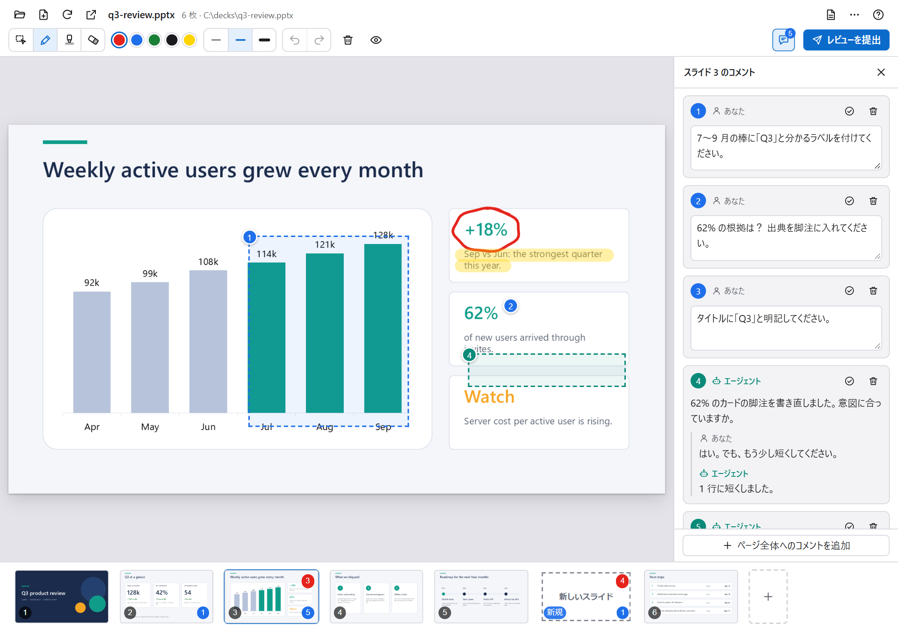
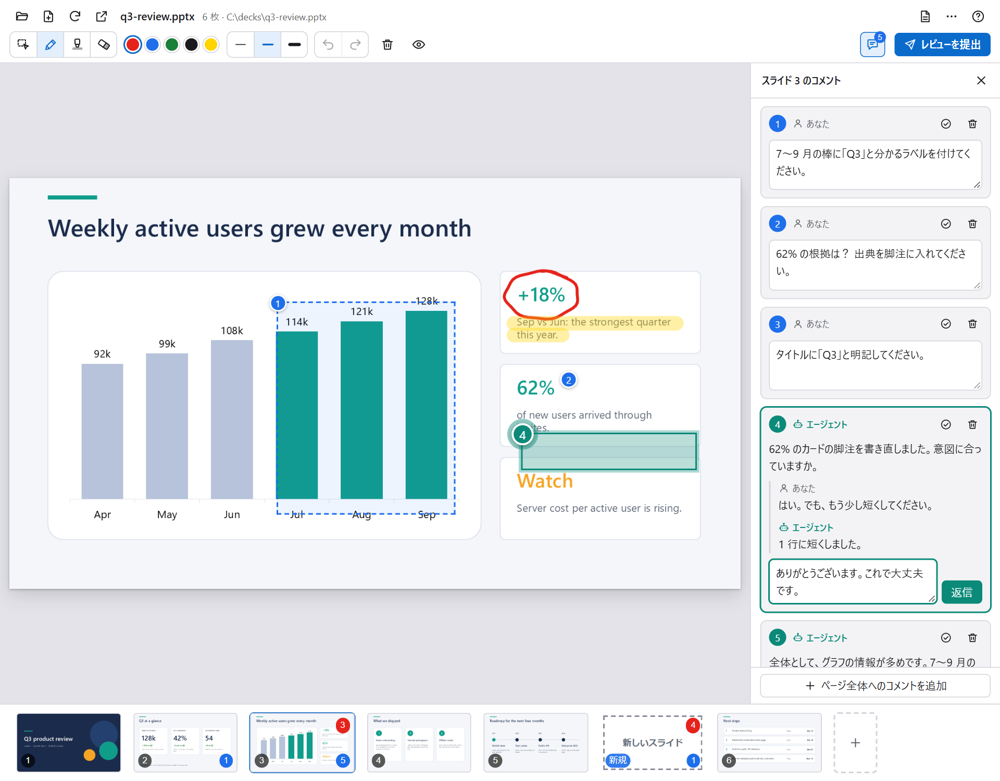
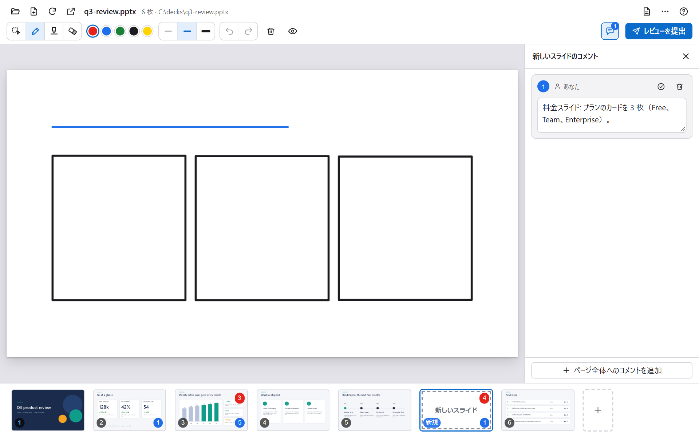
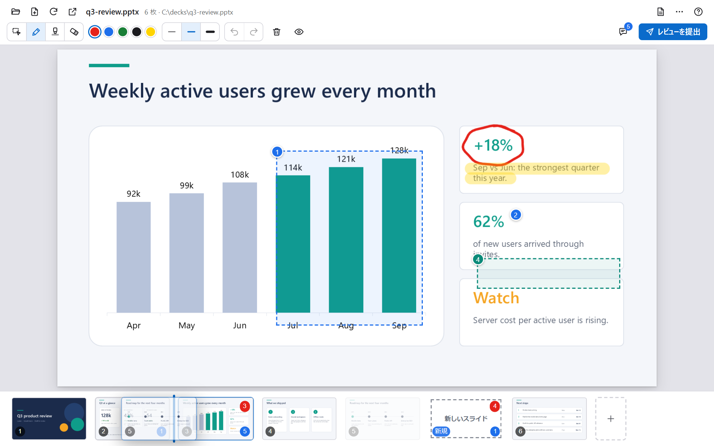
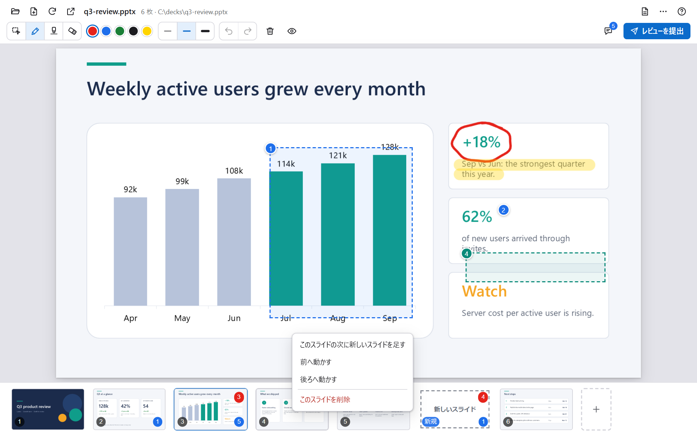
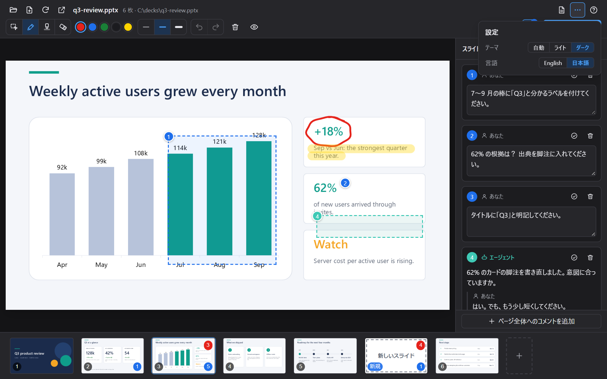

<div align="center">

# Copilot PPTX Review Canvas

**スライドに書き込んで、Copilot のエージェントに直してもらう。**

PowerPoint のレビューを会話に変える [GitHub Copilot のキャンバス](https://code.visualstudio.com/docs/agents/run/canvases)です。間違いを丸で囲み、コメントを付け、足りないスライドをスケッチします。エージェントには、どこを指したのか、ペンの下にどの図形があったのかまで伝わります。

[](./LICENSE)
[](#動作環境)
[](#動作環境)
[](https://code.visualstudio.com/docs/agents/run/canvases)

[English](./README.md) | 日本語



</div>

## なぜ作ったか


資料へのフィードバックをチャットで伝えるには、場所を言葉にする必要があります。「5 ページ目の 3 つ目の箇条書きを短くして」のような指示は時間がかかり、エージェントも意図を推測するしかありません。

このキャンバスでは、言葉の代わりに指し示します。キャンバスはあなたとエージェントの間に入り、エージェントには次の情報が届きます。

- 書き込みと、番号付きのコメントが入ったスライドの画像
- 書き込みとコメントそれぞれの内容と、スライド上の位置
- 書き込みの下にある図形の名前。資料をスクリプトで作っている場合は、スクリプトやテンプレートの該当箇所を探す手がかりになります。

## 機能

- **書き込みとコメント**: ペン、蛍光ペン、消しゴム（`Shift` を押しながら描くと直線、`Ctrl` なら長方形）。コメントは、位置、範囲、スライド全体に付けられます。スライドをクリック、ドラッグ、右クリックして、その場所のそばに出る吹き出しに書きます。
- **エージェントとスレッドで会話**: エージェントも「ここを直しましたが、イメージに合いますか」のようにコメントを付け、あなたのコメントに返信できます。あなたは同じスレッドに返信し、片付いたら解決済みにします。コードレビューのような流れです。
- **新しいスライドをスケッチ**: 好きな場所に白紙のスライドを足し（スケッチブックから始めることもできます）、レイアウトを描くと、エージェントが作ります。
- **並べ替えと削除**: スライドのドラッグか、右クリックのメニューで行います。バックアップを取り、元に戻すこともできます。
- **レビューを提出**: ボタン 1 つで、エージェントに書き込み、コメント、新しいスライドを読んで修正するよう依頼します。
- **ローカルで完結**: 描画はお使いの PowerPoint で行い、データは PC の外に出ません。
- **英語と日本語**の画面。ライトテーマとダークテーマに対応しています。

<details>
<summary>📸 <b>スクリーンショット</b></summary>

<br>

<table>
  <tr>
    <td width="50%"><br><sub><b>コメント</b>: クリック、ドラッグ、右クリックで場所を選び、吹き出しに書きます。</sub></td>
    <td width="50%"><br><sub><b>スレッド</b>: エージェントがコメントと返信をし、あなたが返信して解決します。</sub></td>
  </tr>
  <tr>
    <td width="50%"><br><sub><b>新しいスライド</b>: 案を描けば、エージェントが作ります。</sub></td>
    <td width="50%"><br><sub><b>並べ替え</b>: 一覧でドラッグし、線の位置で離します。</sub></td>
  </tr>
  <tr>
    <td width="50%"><br><sub><b>スライドのメニュー</b>: 右クリックで追加、移動、削除をします。</sub></td>
    <td width="50%"><br><sub><b>設定</b>: テーマ（自動、ライト、ダーク）と言語。</sub></td>
  </tr>
</table>

</details>

## 動作環境

- Windows 10 または 11 と、デスクトップ版の Microsoft PowerPoint。描画に PowerPoint を使うため、Web 版と Mac 版は対象外です。
- キャンバスに対応した Copilot のクライアント。キャンバスはプレビュー機能です。VS Code では `chat.canvases.enabled` を有効にし、Copilot ハーネスで新しいセッションを始めてください。詳しくは [Use canvases with agents](https://code.visualstudio.com/docs/agents/run/canvases)（英語）を参照してください。

## インストール

Copilot CLI では、このリポジトリをマーケットプレイスとして追加し、そこからプラグインをインストールします。

```powershell
copilot plugin marketplace add openjny/copilot-pptx-review-canvas
copilot plugin install copilot-pptx-review-canvas@copilot-pptx-review-canvas
```

VS Code の手順は、[インストールと更新](./docs/ja/install.md#vs-code)を参照してください。インストールのあとは、新しいセッションを始めてください。キャンバスは、インストールのあとに始めたセッションにだけ表示されます。

## はじめかた

1. エージェントに「`samples/q3-review.pptx` を PowerPoint レビューで開いて」と頼みます。最初の描画は、PowerPoint の起動のため数秒かかります。
2. コメントのツール（`C`）でスライドをクリックするか、どのツールでもスライドを右クリックするか、ペン（`P`）で丸を描きます。
3. 右上の「レビューを提出」を押します。エージェントが書き込みとコメントを読み取って資料を直して保存し、キャンバスは自動で更新されます。

## ドキュメント

| | |
|:--|:--|
| [インストールと更新](./docs/ja/install.md) | VS Code の手順、更新、フックについて知っておくこと。 |
| [キャンバスの使い方](./docs/ja/usage.md) | ツールとショートカット、新しいスライド、並べ替え、エージェント向けの操作、言語。 |
| [仕組み](./docs/ja/how-it-works.md) | 書き込みから修正まで、データとプライバシー、制限事項。 |
| [アーキテクチャ](./docs/architecture.md)（英語） | モジュール、HTTP API、保存するデータ。開発者向けです。 |
| [CONTRIBUTING](./CONTRIBUTING.md)（英語） | テストの実行、ガイドライン、リリース。 |

## ライセンス

[MIT](./LICENSE)。Microsoft と PowerPoint は Microsoft グループの商標です。このプロジェクトは独立したもので、Microsoft や GitHub と提携しておらず、承認も受けていません。
