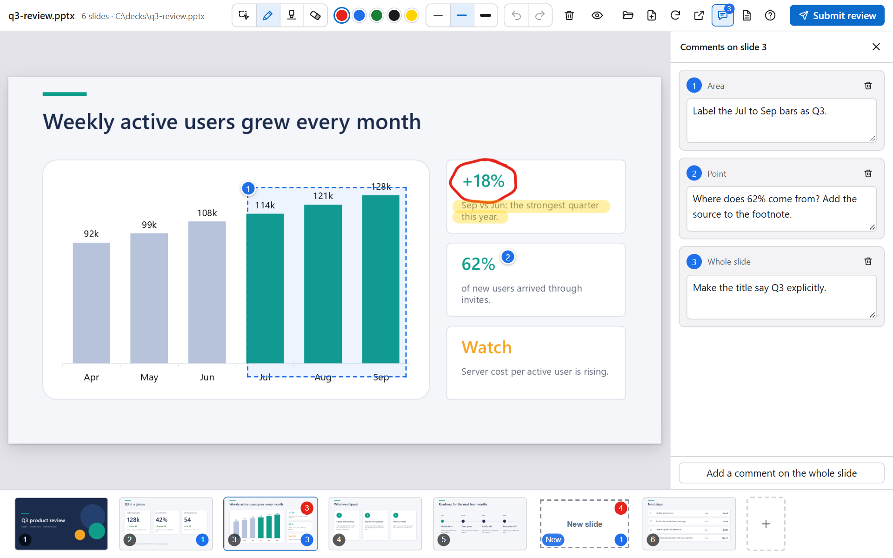
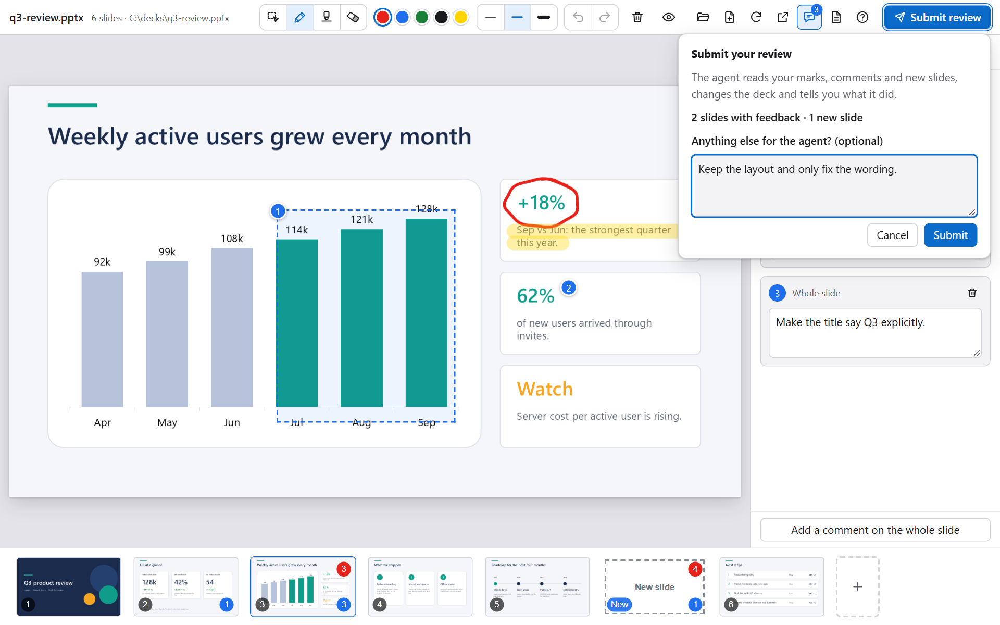
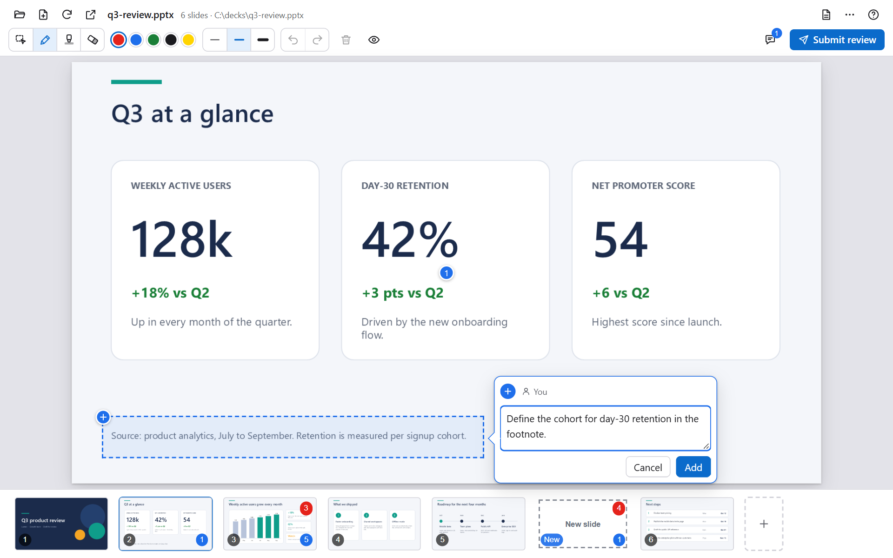
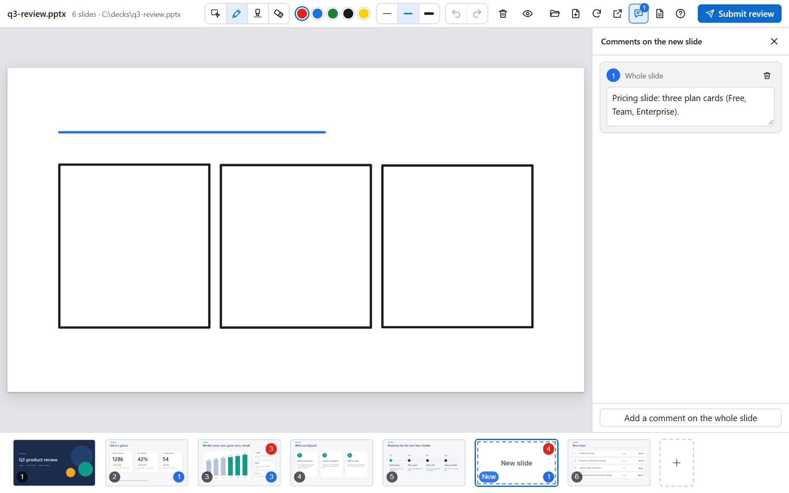
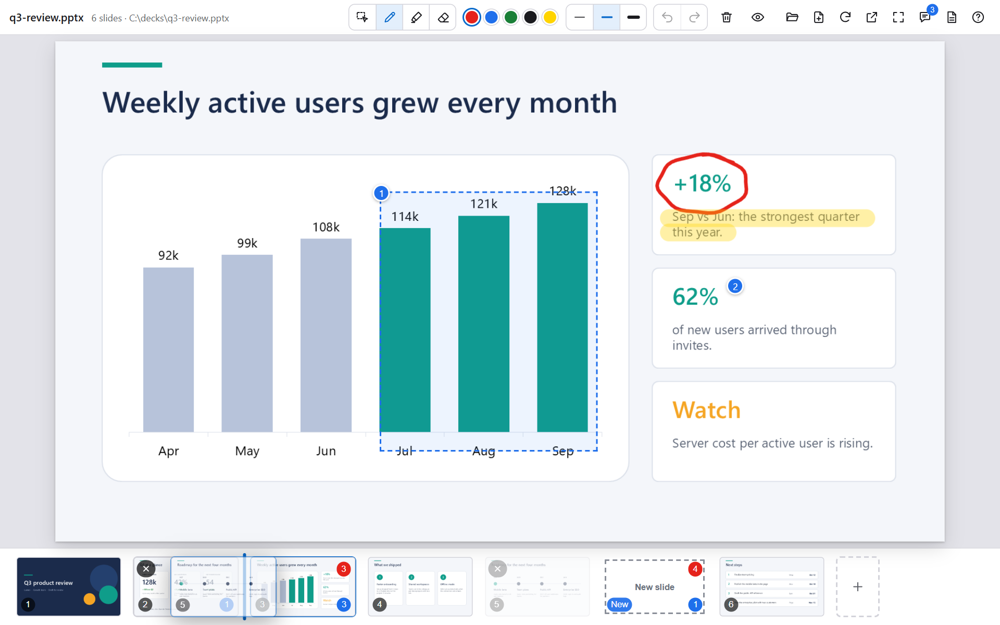

<div align="center">

# Copilot PPTX Review Canvas

**Mark up slides. Let your Copilot agent fix them.**

A [GitHub Copilot canvas](https://code.visualstudio.com/docs/agents/run/canvases) that turns PowerPoint review into a conversation: circle what is wrong, pin a comment, sketch a missing slide. Your agent sees exactly where you pointed, and which shapes were under your pen.

[](./LICENSE)
[](#requirements)
[](#requirements)
[](https://code.visualstudio.com/docs/agents/run/canvases)

English | [日本語](./README.ja.md)



</div>

## Why

Giving feedback on a deck in chat means describing positions in words: "on slide 5, the third bullet, make it shorter". It is slow, and the agent has to guess what you mean.

With this canvas you point instead. The agent receives:

- the slide image with your marks and numbered comments on it,
- each mark and comment as data, with its position on the slide,
- the names of the shapes under each mark, which map back to your build script or template when the deck is generated.

## Features

- **Draw and comment**: pen, highlighter and eraser, and comments on a point, an area or the whole slide.
- **Sketch new slides**: add a blank slide anywhere, or start a sketchbook, and draw the layout for the agent to build.
- **Reorder and delete** slides, with a backup and undo.
- **Submit review**: one button asks the agent to read your marks, comments and new slides, and to make the changes.
- **Local and private**: slides are rendered by your own PowerPoint, and nothing leaves your PC.
- **English and Japanese** interface.

<table>
  <tr>
    <td width="50%"><br><sub><b>Submit review</b>: one button sends everything to the agent.</sub></td>
    <td width="50%"><br><sub><b>Comments</b>: a point, an area or the whole slide.</sub></td>
  </tr>
  <tr>
    <td width="50%"><br><sub><b>New slide</b>: sketch an idea, the agent builds it.</sub></td>
    <td width="50%"><br><sub><b>Reorder</b>: drag in the strip and drop at the line.</sub></td>
  </tr>
</table>

## Requirements

- Windows 10 or 11 with desktop Microsoft PowerPoint. Slides are rendered through PowerPoint, so PowerPoint for the web and for Mac are not supported.
- A Copilot client with canvas support. Canvases are in preview. In VS Code, turn on `chat.canvases.enabled`, then start a new session with the Copilot harness. See [Use canvases with agents](https://code.visualstudio.com/docs/agents/run/canvases).

## Install

With the Copilot CLI, add this repository as a marketplace and install the plugin from it:

```powershell
copilot plugin marketplace add openjny/copilot-pptx-review-canvas
copilot plugin install copilot-pptx-review-canvas@copilot-pptx-review-canvas
```

For VS Code, see [Install and update](./docs/install.md#vs-code). Start a new session afterwards: a canvas appears only in sessions that begin after the plugin is installed.

## Quick start

1. Ask your agent: *"Open `samples/q3-review.pptx` in PowerPoint Review."* The first render takes a few seconds while PowerPoint starts.
2. Pick the comment tool (`C`) and click a spot on a slide, or circle something with the pen (`P`).
3. Press **Submit review** at the top right. The agent reads your marks and comments, edits the deck and saves it, and the canvas refreshes by itself.

## Documentation

| | |
|:--|:--|
| [Install and update](./docs/install.md) | Steps for VS Code, updating, and what to know about the hook. |
| [Using the canvas](./docs/usage.md) | Tools and shortcuts, new slides, reordering, the actions for the agent, language. |
| [How it works](./docs/how-it-works.md) | From marks to changes, data and privacy, limitations. |
| [Architecture](./docs/architecture.md) | Modules, HTTP API and stored data, for contributors. |
| [Contributing](./CONTRIBUTING.md) | Running the tests, guidelines, releasing. |

## License

[MIT](./LICENSE). Microsoft and PowerPoint are trademarks of the Microsoft group of companies. This project is independent and is not affiliated with or endorsed by Microsoft or GitHub.
