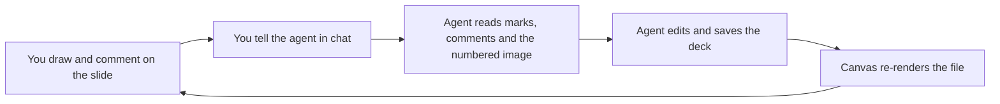

<div align="center">

# Copilot PPTX Review Canvas

**Mark up slides. Let your Copilot agent fix them.**

A [GitHub Copilot canvas](https://code.visualstudio.com/docs/agents/run/canvases) that turns PowerPoint review into a conversation: circle what is wrong, pin a comment, sketch a missing slide. Your agent sees exactly where you pointed, and which shapes were under your pen.

[](./LICENSE)
[](#requirements)
[](#requirements)
[](https://code.visualstudio.com/docs/agents/run/canvases)

English | [日本語](./README.ja.md)


</div>

## Why

Giving feedback on a deck in chat means describing positions in words: "on slide 5, the third bullet, make it shorter". It is slow, and the agent has to guess what you mean.

With this canvas you point instead. The agent receives:

- the slide image with your marks and numbered comments on it,
- each mark and comment as data, with its position on the slide,
- the names of the shapes under each mark, which map back to your build script or template when the deck is generated.

Then it edits the deck, the canvas re-renders the file by itself, and you review again.

## Features

| | |
|:--|:--|
| **Draw on slides** | Pen, highlighter and eraser, five colors, three widths, undo and redo. Marks are kept per slide and stay on a slide as long as its picture does not change. |
| **Comment like in PowerPoint** | Click a spot, drag an area, or comment on the whole slide. Pins are numbered and the same numbers reach the agent. |
| **Sketch new slides** | Add a blank slide between any two slides and sketch the layout. It exists only in the viewer until the agent builds it. No deck yet? Start a sketchbook. |
| **Reorder and delete** | Drag slides in the strip to reorder, or remove them, with a backup of the file and undo. Only the slide list inside the `.pptx` is rewritten, so nothing is re-saved by PowerPoint. |
| **Made for the agent** | Actions to open a deck, jump to a slide, read the outline, notes and marks, and rebuild. It tells the agent when you have unread marks. |
| **Local and private** | Renders through your own PowerPoint. Everything stays on your PC: no telemetry, no remote assets. |
| **English and Japanese** | Switch in the help panel. |

<table>
  <tr>
    <td width="50%"><br><sub><b>Comments</b>: a point, an area or the whole slide.</sub></td>
    <td width="50%"><br><sub><b>New slide</b>: sketch an idea, the agent builds it.</sub></td>
  </tr>
  <tr>
    <td width="50%"><br><sub><b>Reorder</b>: drag in the strip and drop at the line.</sub></td>
    <td width="50%"><br><sub><b>Notes</b>: read the speaker notes while you review.</sub></td>
  </tr>
</table>

## How it works



- Marks are stored as fractions of the slide (0 to 1), so they stay in place at any window size.
- When the agent saves a new version, marks stay on slides whose picture did not change. Marks on changed slides move to an archive, so old feedback does not point at new content.
- On your next message, the canvas tells the agent which slides have marks it has not read yet.
- The canvas does not edit slide content. Your agent does that with its own tools, such as python-pptx, a build script or PowerPoint automation.

## Requirements

- Windows 10 or 11.
- Microsoft PowerPoint (desktop). Slides are rendered through PowerPoint, so PowerPoint for the web and for Mac are not supported.
- A Copilot client with canvas support. Canvases are in preview. In VS Code, turn on `chat.canvases.enabled`, then start a new session with the Copilot harness. See [Use canvases with agents](https://code.visualstudio.com/docs/agents/run/canvases).

## Install

With the Copilot CLI, add this repository as a marketplace and install the plugin from it:

```powershell
copilot plugin marketplace add openjny/copilot-pptx-review-canvas
copilot plugin install copilot-pptx-review-canvas@copilot-pptx-review-canvas
```

In VS Code, add this repository as a marketplace and install the plugin from it. Run **Chat: Open Customizations**, select **Browse**, open the source menu, choose **Configure Marketplaces** and then **Add Marketplace**, and enter `openjny/copilot-pptx-review-canvas`. Back in **Browse**, pick that marketplace from the source menu and select **Install** on the plugin.

Start a new session afterwards: a canvas appears only in sessions that begin after the plugin is installed. To update, run `copilot plugin update copilot-pptx-review-canvas@copilot-pptx-review-canvas`.

> [!NOTE]
> The canvas id is `pptx-review-canvas`. Install the plugin from one source only: the same plugin installed from two sources registers the canvas twice.

> [!NOTE]
> The extension registers one hook that runs when you send a message: if you have marks that the agent has not read yet, it adds a short hidden note saying so. Because hooks are a privileged capability, your Copilot client asks you to approve the extension the first time. The hook is in [`extension.mjs`](./com.github.copilot/extensions/pptx-review-canvas/extension.mjs).

## Quick start

1. Start a new Copilot session and ask: *"Open `samples/q3-review.pptx` in PowerPoint Review."* The first render takes a few seconds while PowerPoint starts.
2. Pick the comment tool (`C`) and click a spot on a slide, or draw a circle with the pen (`P`). Add a few comments.
3. Tell the agent what to do: *"Apply my marks and comments."* It reads them, edits the deck and saves. The canvas refreshes by itself.

To start from nothing, use **Open a deck** in the top bar, then **Start a sketchbook**, or ask the agent to create a new deck.

## Using the canvas

| Tool | Key | What it does |
|:--|:--|:--|
| Comment | `C` | Click for a point, drag for an area. A comment on the whole slide is added from the comment list. |
| Pen | `P` | Draws on the slide. |
| Highlighter | `H` | Draws a wide, translucent stroke. |
| Eraser | `E` | Removes strokes. |
| Undo and redo | `Ctrl+Z` `Ctrl+Y` | Undoes marks, comment deletions and slide deletions, latest first. |
| Show or hide marks | `M` | |
| Notes | `N` | Shows the speaker notes. |
| Full screen | `F` | |
| Previous and next slide | `←` `→` | |
| Move the current slide | `Alt+←` `Alt+→` | Rewrites the `.pptx`; a backup is kept. |
| New slide after the current one | `Ctrl+M` | |
| Delete the current slide | `Delete` | Undo with `Ctrl+Z`. |

Hover between two slides in the strip and press **+** to add a new slide there. Press **?** for the in-app help.

> [!TIP]
> Reordering and deleting rewrite the `.pptx`, so close the deck in PowerPoint first. If the deck is generated by a script, change the script too, or the next build brings the old order back.

### Actions for the agent

| Action | What it does |
|:--|:--|
| `open_deck` | Opens a `.pptx` and waits until it is rendered. |
| `go_to_slide` | Shows a slide. |
| `get_slide` | Reads a slide's title and notes, optionally with its image. |
| `get_outline` | Reads every title with the count of marks and comments, and the new slides. |
| `get_annotations` | Reads marks and comments as data, with numbered images. Marks them as read. |
| `resolve_drafts` | Removes new slides that the agent has turned into real slides. |
| `new_sketchbook` | Starts, or continues, a sketchbook. |
| `move_slide` | Moves a slide (rewrites the file). |
| `new_deck` | Creates a one-slide `.pptx`, blank or from a template, and opens it. |
| `refresh` | Renders the deck again. |

## Data and privacy

Everything is stored under `~/.copilot/extension-data/pptx-review-canvas/`: rendered images, marks, comments, new slides, backups of files before a rewrite, and the last slide you looked at in each deck. Nothing leaves your PC.

- The viewer is a small web server on `127.0.0.1` with a random port, for the open canvas only. It rejects other hosts and other origins.
- Decks are opened read-only in PowerPoint with macros disabled and no prompts.
- A `.pptx` is rewritten only when you reorder or delete slides, after a backup. The backup is the last one per file.

## Limitations

- Windows and desktop PowerPoint only.
- Slides are shown as static images: animations, transitions, video and embedded media do not play.
- Reordering and deleting do not work on decks that another app has open, on legacy formats such as `.ppt`, and on sketchbooks. The reason is shown at the top of the viewer.
- You cannot delete the last slide, or a slide that other slides link to.
- Canvases are a preview feature of the Copilot clients, so the extension API can change.

## Development

```powershell
npm test
```

No `npm install` is needed: the extension has no dependencies and no build step. See [CONTRIBUTING.md](./CONTRIBUTING.md) and [docs/architecture.md](./docs/architecture.md). The sample deck is generated by [`scripts/make_sample_deck.py`](./scripts/make_sample_deck.py).

## License

[MIT](./LICENSE). Microsoft and PowerPoint are trademarks of the Microsoft group of companies. This project is independent and is not affiliated with or endorsed by Microsoft or GitHub.
