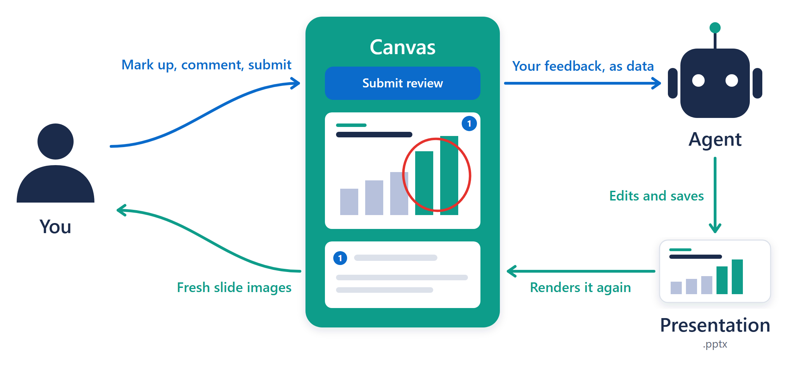
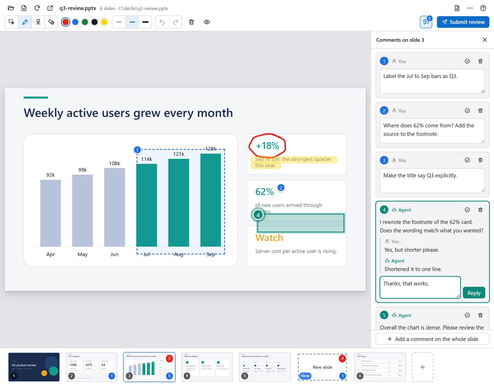
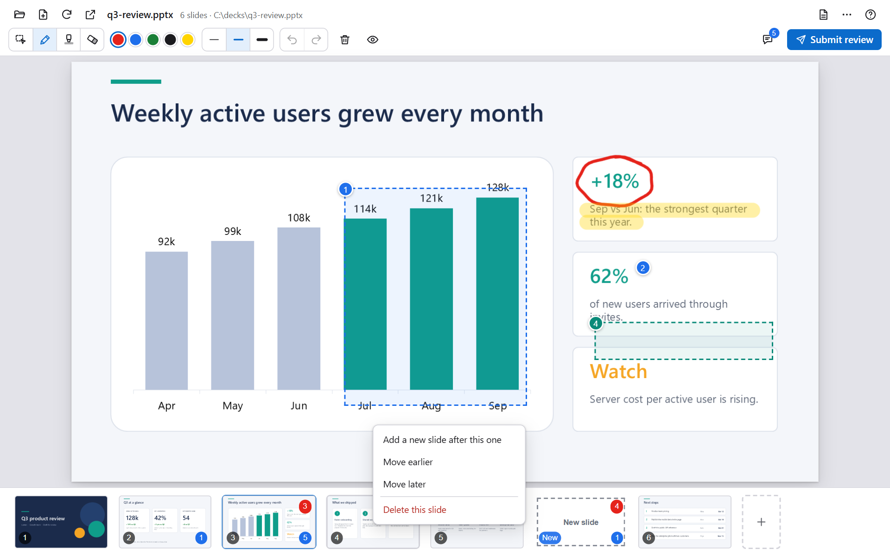
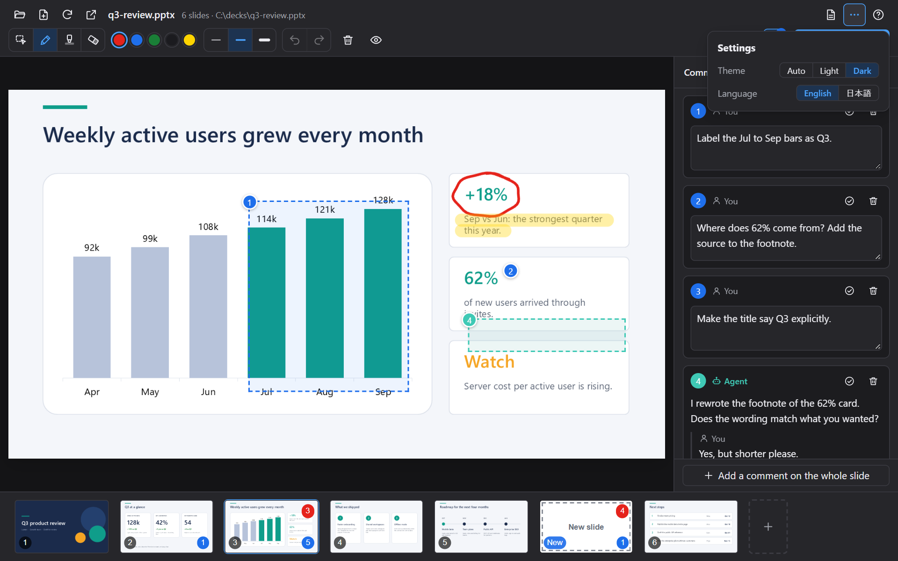

<div align="center">

# Copilot PPTX Review Canvas

**Mark up slides. Let your Copilot agent fix them.**

A [GitHub Copilot canvas](https://code.visualstudio.com/docs/agents/run/canvases) that turns PowerPoint review into a conversation: circle what is wrong, pin a comment, sketch a missing slide. Your agent sees exactly where you pointed, and which shapes were under your pen.

[](./LICENSE)
[](#requirements)
[](#requirements)
[](https://code.visualstudio.com/docs/agents/run/canvases)

English | [日本語](./README.ja.md)


</div>

## Why

Even when agents produce the deliverables, deciding what is good is still up to people. This canvas passes your intent and your judgment to the agent in a form it can use, and keeps the whole exchange with the agent on one screen.

- **Why does the agent need your intent at all?** Once models and agents can produce high-quality deliverables without any instructions, being able to produce the same thing has no value. That your ideas and your thinking create value has not changed in any era.
- **Why review instead of editing the .pptx directly?** In the short run, editing directly is often cheaper. In the long run, it pays to keep a log of what you thought while reviewing (a trace of your thinking). For example, a review log lets you turn recurring corrections into a skill, so the same mistakes are not repeated.
- **Why not just tell the agent in chat?** Text cannot carry all of your intent. Clicking the spot you are looking at to attach a comment, or sketching an idea with the freehand pen, gets much more information to the agent, faster.
- **Why not review in PowerPoint?** PowerPoint comments make reviewing efficient, but you have to leave the UI where GitHub Copilot runs (for example, VS Code). With the canvas, instructing the agent and reviewing its output both happen in the application that runs the agent.
- **Why not build a review page in HTML and show it in the Integrated Browser?** A canvas can embed an API for talking to the agent. The agent can operate the canvas (for example, open a deck, comment and reply), and you can instruct the agent through the canvas (for example, **Submit review** asks it to make the changes). The whole exchange between you and the agent goes through the canvas. See the [actions for the agent](./docs/usage.md#actions-for-the-agent).


## Features

- **Draw and comment**: pen, highlighter and eraser (hold `Shift` for a straight line, `Ctrl` for a rectangle). Comment on a point, an area or the whole slide: click, drag or right-click the slide and write in a bubble beside the spot.
- **Talk with the agent in threads**: the agent can leave comments of its own ("I changed this, does it match?") and reply to yours. You reply in the same thread and resolve it when it is settled, like a code review.
- **Sketch new slides**: add a blank slide anywhere, or start a sketchbook, and draw the layout for the agent to build.
- **Reorder and delete** slides by dragging them, or from the right-click menu of a slide, with a backup and undo.
- **Submit review**: one button asks the agent to read your marks, comments and new slides, and to make the changes.
- **Local and private**: slides are rendered by your own PowerPoint, and nothing leaves your PC.
- **English and Japanese** interface, in a light or dark theme.

<details>
<summary>📸 <b>Screenshots</b></summary>

<br>

<table>
  <tr>
    <td width="50%"><br><sub><b>Comments</b>: click, drag or right-click a spot and write in the bubble.</sub></td>
    <td width="50%"><br><sub><b>Threads</b>: the agent comments and replies, you reply and resolve.</sub></td>
  </tr>
  <tr>
    <td width="50%"><br><sub><b>New slide</b>: sketch an idea, the agent builds it.</sub></td>
    <td width="50%"><br><sub><b>Reorder</b>: drag in the strip and drop at the line.</sub></td>
  </tr>
  <tr>
    <td width="50%"><br><sub><b>Slide menu</b>: right-click a slide to add, move or delete it.</sub></td>
    <td width="50%"><br><sub><b>Settings</b>: theme (auto, light, dark) and language.</sub></td>
  </tr>
</table>

</details>

## Requirements

- Windows 10 or 11 with desktop Microsoft PowerPoint. Slides are rendered through PowerPoint, so PowerPoint for the web and for Mac are not supported.
- A Copilot client with canvas support. Canvases are in preview. In VS Code, turn on `chat.canvases.enabled`, then start a new session with the Copilot harness. See [Use canvases with agents](https://code.visualstudio.com/docs/agents/run/canvases).

## Install

With the Copilot CLI, add this repository as a marketplace and install the plugin from it:

```powershell
copilot plugin marketplace add openjny/copilot-pptx-review-canvas
copilot plugin install copilot-pptx-review-canvas@copilot-pptx-review-canvas
```

For VS Code, see [Install and update](./docs/install.md#vs-code). Start a new session afterwards: a canvas appears only in sessions that begin after the plugin is installed.

## Quick start

1. Ask your agent: *"Open `samples/q3-review.pptx` in PowerPoint Review."* The first render takes a few seconds while PowerPoint starts.
2. Pick the comment tool (`C`) and click a spot on a slide, or right-click a spot with any tool, or circle something with the pen (`P`).
3. Press **Submit review** at the top right. The agent reads your marks and comments, edits the deck and saves it, and the canvas refreshes by itself.

## Documentation

| | |
|:--|:--|
| [Install and update](./docs/install.md) | Steps for VS Code, updating, and what to know about the hook. |
| [Using the canvas](./docs/usage.md) | Tools and shortcuts, new slides, reordering, the actions for the agent, language. |
| [How it works](./docs/how-it-works.md) | From marks to changes, data and privacy, limitations. |
| [Architecture](./docs/architecture.md) | Modules, HTTP API and stored data, for contributors. |
| [Contributing](./CONTRIBUTING.md) | Running the tests, guidelines, releasing. |

## License

[MIT](./LICENSE). Microsoft and PowerPoint are trademarks of the Microsoft group of companies. This project is independent and is not affiliated with or endorsed by Microsoft or GitHub.
