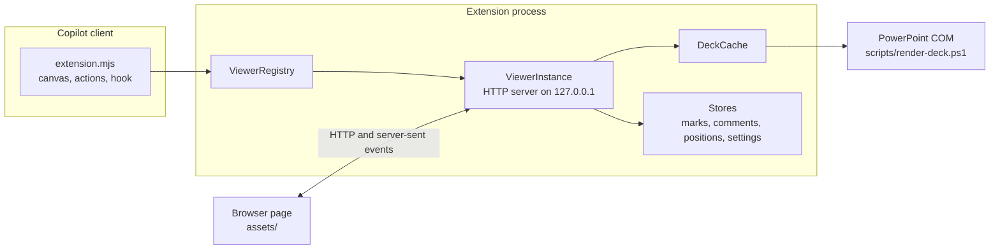

# Architecture

How the canvas is built, for contributors and for anyone who wants to understand what it does to a deck.

## Overview

- The Copilot client loads `extension.mjs`, which registers one canvas (`pptx-review-canvas`) and its actions.
- Each open canvas gets a `ViewerInstance`: a small HTTP server bound to `127.0.0.1` on a random port that serves the page and a JSON API, and pushes state changes over server-sent events. The page is shown inside the canvas.
- `DeckCache` renders a deck once with desktop PowerPoint and shares the result between viewers.
- Marks, comments and new slides are stored per deck path and shared by every viewer of that deck.

## Modules

All paths are inside `com.github.copilot/extensions/pptx-review-canvas/`.

| File | Responsibility |
|:--|:--|
| `extension.mjs` | Registers the canvas, validates action input, sends the message of a submitted review to the agent's session, and adds a hook that tells the agent about unread marks. |
| `lib/registry.mjs` | One viewer per canvas instance; owns the shared stores, the deck cache and the i18n object. |
| `lib/viewer-instance.mjs` | The HTTP server, state snapshots and events, file watching, and the API for marks, comments, new slides, reordering, deleting and creating decks. |
| `lib/deck-cache.mjs` | Render cache. Shares a running render and stops it only when everyone gave up. Reordering reuses already rendered images (`derive`). |
| `lib/renderer.mjs`, `scripts/render-deck.ps1` | Exports slide and thumbnail PNGs, titles, notes and shape geometry through PowerPoint COM. |
| `lib/new-deck.mjs`, `scripts/new-deck.ps1` | Picks a free file name and creates a one-slide `.pptx` through PowerPoint COM. |
| `lib/powershell.mjs` | Locates Windows PowerShell 5.1. |
| `lib/pptx-zip.mjs` | Reads the ZIP directory of a `.pptx`, replaces one part, removes parts; every other part is copied byte for byte. |
| `lib/pptx-reorder.mjs` | Rewrites the slide order and sections in `ppt/presentation.xml`, checks the result, keeps a backup and writes atomically. `commitRewrite` is shared with deletion. |
| `lib/pptx-delete.mjs` | Removes a slide from the list, sections and custom shows, then follows the relationships to remove only the parts that nothing else uses. |
| `lib/history.mjs` | The linear undo and redo history of one viewer. Releases kept files when an entry falls out of the history. |
| `lib/sketchbook.mjs` | Creates sketchbooks and renders their blank pages. |
| `lib/comments.mjs` | Validates comments (trimmed text up to 2000 characters, anchors as fractions, tiny areas become points) and classifies them as `page`, `point` or `area`. |
| `lib/annotations.mjs` | Validates, stores and carries over marks, comments and new slides. They follow a slide by the hash of its image, or by position. |
| `lib/marks.mjs` | Groups strokes into marks and finds the shapes under a mark or comment. |
| `lib/raster.mjs`, `lib/png.mjs` | Draws mark numbers (black) and comment rectangles and numbers (blue) onto PNGs, and writes blank pages. |
| `lib/store.mjs` | Atomic record files, the data root, per-deck last position, and settings (the language and the width of the comments pane). |
| `lib/i18n.mjs`, `lib/locales/` | Message catalogs for everything the server says, see [Languages](#languages). |
| `assets/index.html`, `assets/styles.css` | Structure and look. The page policy is `style-src 'self'`, so there are no inline styles. |
| `assets/main.js` | The page: the strip, the **+** buttons, new slides, keys, help, opening and creating decks. |
| `assets/ink.js` | Drawing, the comment tool (click for a point, drag for an area), tools, undo and redo. |
| `assets/comments.js` | The comment list, pins on the slide, and adding, editing and deleting comments. |
| `assets/resize.js` | The drag handle on the left edge of the comment pane: pointer and keyboard, limits, and reporting the final width for saving. |
| `assets/review.js` | The Submit review button and its panel (optional note); shows when a review can be submitted and posts it. |
| `assets/drag.js` | Horizontal drag in the strip; works out where the slide would go, `main.js` performs the move. |
| `assets/i18n.js`, `assets/locales/` | Message catalogs for the page. |
| `assets/icons.js` | Inline SVG icons. |

## HTTP API

The page talks to its own server only. Requests must come from the loopback host and port of that server, and a `POST` body must be JSON; anything else is rejected with `403` or `415`.

| Route | Purpose |
|:--|:--|
| `GET /api/state`, `GET /api/events` | The state snapshot, and the stream of changes. |
| `GET /api/annotations`, `POST /api/annotations/add`, `.../remove`, `.../clear` | Marks of a slide or a new slide. |
| `GET /api/comments`, `POST /api/comments/add`, `.../update`, `.../remove` | Comments. |
| `POST /api/drafts/add`, `.../move`, `.../remove` | New slides (drafts). |
| `POST /api/sketchbook` | Start a sketchbook. |
| `GET /api/new-deck/suggest`, `POST /api/new-deck` | Create a one-slide deck. |
| `POST /api/slides/move`, `POST /api/slides/delete` | Rewrite the `.pptx`. |
| `POST /api/history/undo`, `.../redo` | Undo and redo. |
| `POST /api/open`, `/api/current`, `/api/refresh`, `/api/open-external` | Open a deck, change slide, render again, open in PowerPoint. |
| `POST /api/language` | Switch the language. |
| `POST /api/comments-width` | Save the width of the comment pane in pixels (`null` for the default). |
| `POST /api/review/submit` | Send the review to the agent: `{ note? }`. Answers `409` when there is nothing new to submit, when the same marks were already submitted, or when the agent's session cannot be reached. |

## Submitting a review

A viewer is created with a `sendToAgent` function by the registry, which `extension.mjs` fills with `session.send({ prompt, displayPrompt })` (the session object that `joinSession` returned). The message is queued behind whatever the agent is doing, and the chat shows the short `displayPrompt` instead of the whole prompt.

- `ViewerInstance.reviewInfo()` is what the page reads (`state.review`): the slides and new slides the agent has not read, and whether they were submitted already. A submission remembers the version of the marks (`deckKey:rev`); any change to the marks makes a new version, and reading them clears the unread flags, so the button comes back on only for new feedback.
- The prompt names the deck and the canvas instance, lists what is new, carries the user's note, and tells the agent to call `get_annotations` and to ask before editing when a comment is unclear. It follows the current language, like the hook text.
- The hook that adds the unread-marks note leaves this message alone, because the message already says where to read.

## Rewriting a deck

Reordering and deleting are the only features that write to a `.pptx`. They work on the ZIP package directly instead of saving through PowerPoint, so nothing else in the file changes:

1. `pptx-zip` reads the directory of the ZIP and checks that it is a sane package.
2. The slide list, the sections and the custom shows in `ppt/presentation.xml` are rewritten. A deletion also removes the parts that only that slide used (notes, its own images) and keeps layouts and anything shared.
3. The result is validated, the original is saved under `backups/`, and the new file replaces the old one atomically.
4. For a deletion, the file as it was is also kept under `undo/` so that **Undo** can put it back byte for byte.

The viewer refuses to rewrite a deck that is open in another app, was changed elsewhere after the page was opened, is a legacy format, or is a sketchbook.

## Data

Everything is kept under `~/.copilot/extension-data/pptx-review-canvas/` (or `$COPILOT_HOME/extension-data/...`).

| Path | Content |
|:--|:--|
| `decks/<key>/` | Slide and thumbnail PNGs, `manifest.json`, `shapes.json`. The key comes from the path, size and modification time. |
| `positions/` | The slide each deck was left on. |
| `annotations/` | Marks, comments and new slides per deck path. `archive/` holds marks of slides that changed or were deleted. |
| `sketchbooks/` | A marker file per sketchbook (`<name>.sketch`); its single blank page is rendered into `decks/`. |
| `backups/` | The deck as it was before a rewrite: the last one per file, and at most the newest five overall. |
| `undo/` | The deck as it was before a deletion, for undo. Cleaned when the history ends, and at start-up when older than a day. |
| `work/` | Temporary render directories. |
| `settings.json` | The chosen language and the width of the comment pane. Each is saved only once the user chooses it. |

Records are `{ format, version, data }` files written atomically. A record that cannot be read is renamed to `*.corrupt-<time>` instead of being overwritten.

## Languages

English is the default and Japanese is the second language. The server (`lib/locales/`) and the page (`assets/locales/`) each have a catalog per language, addressed by dotted keys with `{placeholder}` templates; a missing key falls back to English.

- The language is stored in `settings.json`. When there is none, `PPTX_CANVAS_LANG` (`en` or `ja`) is used, then English.
- `POST /api/language` saves the choice, switches the shared server catalog and pushes a new state to every open viewer. The state carries texts that were rendered in the current language, and `language` itself; the page switches its own catalog when it sees a new value.
- Errors raised deep in the code carry a message key and parameters, so an error that is still in the state is shown in the new language after a switch.
- The canvas name is registered once at start-up, so it follows a language change only after the next start. Text meant for the agent (action descriptions, the format of marks) stays in English; the texts of the unread-marks hook and of errors follow the language.
- New slides are always named `New slide N` in data; the Japanese names written by earlier versions are still recognized and rewritten when read.

`test/i18n.test.mjs` and `test/ui-i18n.test.mjs` check that both catalogs have the same keys and placeholders, and that every key used in the code exists.
