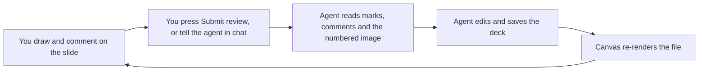

# How it works

[日本語](./ja/how-it-works.md)

## From marks to changes

- Marks are stored as fractions of the slide (0 to 1), so they stay in place at any window size.
- **Submit review** sends a message to the agent in the session that opened the canvas. It says which deck and which slides have new feedback, and tells the agent to read everything with `get_annotations`. It is sent the moment you press the button, with no confirmation step. If the agent is busy, the message waits its turn. Only feedback the agent has not read yet can be submitted, and the same feedback only once; drawing or commenting again makes the button available again.
- The agent can write back. `add_comment` leaves a comment of its own on a spot or on the whole slide ("I changed this, does it match?", "this claim is weak, please review it closely"), and `reply_to_comment` answers in a thread. These are marked as the agent's and drawn in teal. You reply in the same thread and resolve it when it is settled. Your comments and replies are feedback the agent has not read; its own comments, and resolving a thread, are not.
- When the agent saves a new version, marks stay on slides whose picture did not change. Marks on changed slides move to an archive, so old feedback does not point at new content.
- If you write to the agent in chat instead (for example *"Apply my marks and comments."*), the canvas tells it on your next message which slides have marks it has not read yet.
- The canvas does not edit slide content. Your agent does that with its own tools, such as python-pptx, a build script or PowerPoint automation.

## Data and privacy

Everything is stored under `~/.copilot/extension-data/pptx-review-canvas/`: rendered images, marks, comments, new slides, backups of files before a rewrite, the last slide you looked at in each deck, and your settings. Nothing leaves your PC, and there is no telemetry.

- The viewer is a small web server on `127.0.0.1` with a random port, for the open canvas only. It rejects other hosts and other origins.
- Decks are opened read-only in PowerPoint with macros disabled and no prompts.
- A `.pptx` is rewritten only when you reorder or delete slides, after a backup. The backup is the last one per file.

## Limitations

- Windows and desktop PowerPoint only.
- Slides are shown as static images: animations, transitions, video and embedded media do not play.
- Reordering and deleting do not work on decks that another app has open, on legacy formats such as `.ppt`, and on sketchbooks. The reason is shown at the top of the viewer.
- You cannot delete the last slide, or a slide that other slides link to.
- Canvases are a preview feature of the Copilot clients, so the extension API can change.

For the modules, the HTTP API and the stored data in detail, see [Architecture](./architecture.md).
