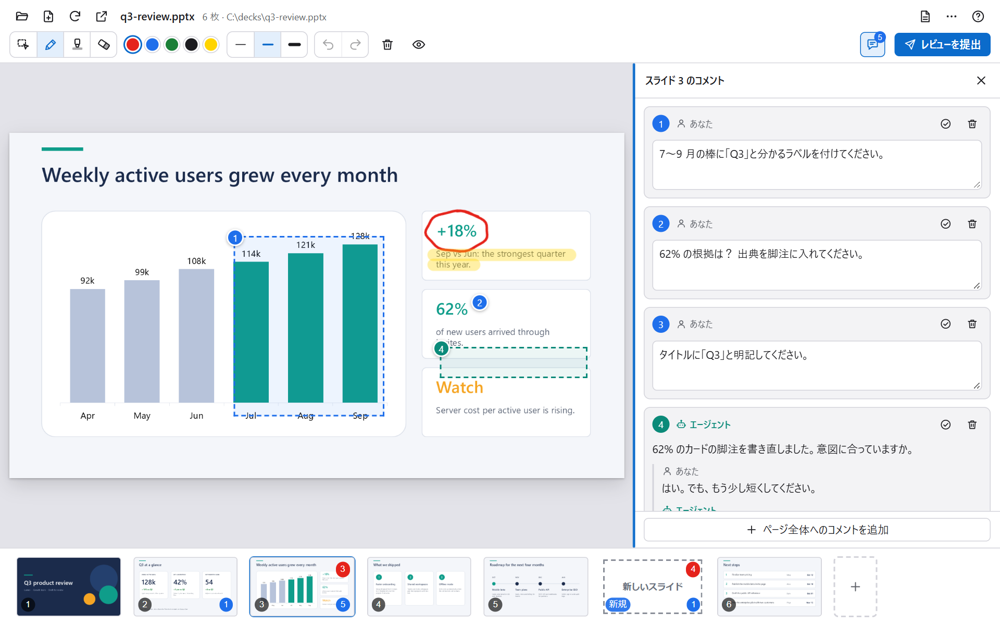
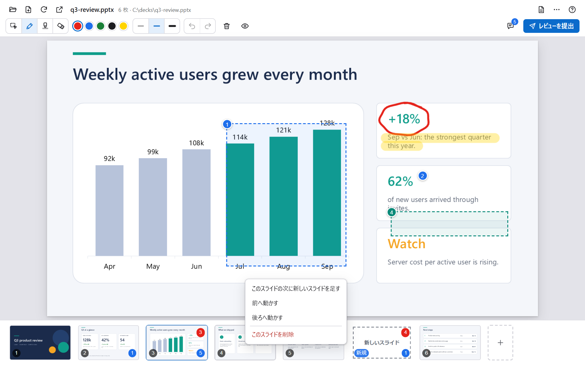
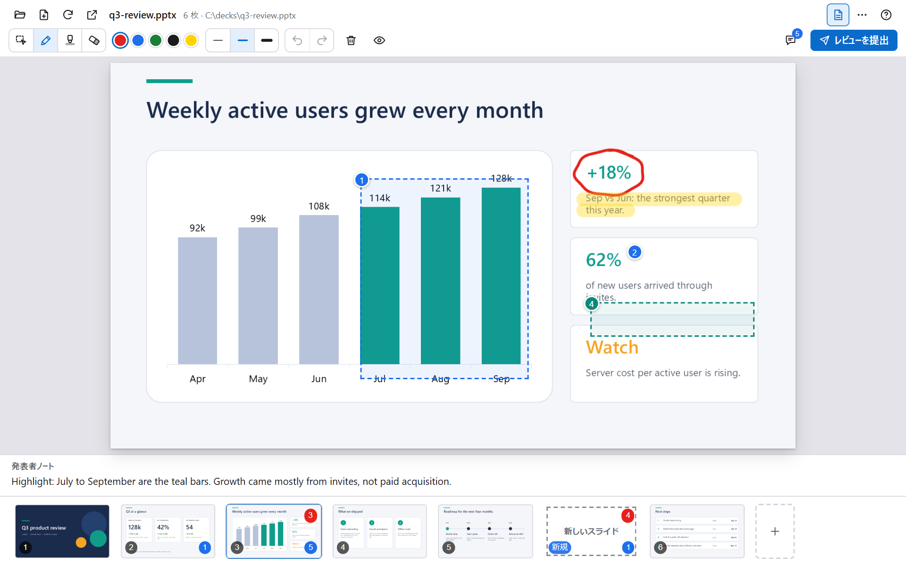

# キャンバスの使い方

[English](../usage.md)

ビューアの「？」を押すと、同じショートカットを載せた画面内のヘルプが開きます。

## ツールとショートカット

ツールバーには、コメント、ペン、蛍光ペン、消しゴム、5 色の色、3 段階の太さ、元に戻す・やり直すがあります。

| ツール | キー | 内容 |
|:--|:--|:--|
| コメント | `C` | クリックで位置に、ドラッグで範囲に付け、吹き出しに書きます。[コメントとスレッド](#コメントとスレッド)を参照してください。 |
| ペン | `P` | スライドに描きます。`Shift` を押しながらで直線、`Ctrl` を押しながらで長方形になります。 |
| 蛍光ペン | `H` | 太くて半透明の線を引きます。`Shift` と `Ctrl` はペンと同じです。 |
| 消しゴム | `E` | 書き込みを消します。 |
| 右クリック | | どのツールでも、その位置にコメントします。右ボタンでドラッグすると、範囲にコメントします。 |
| 元に戻す・やり直す | `Ctrl+Z` `Ctrl+Y` | 書き込み、コメントの削除、スライドの削除を、あとにしたものから順に戻します。 |
| 書き込みの表示・非表示 | `M` | |
| ノート | `N` | 発表者ノートを表示します。 |
| 前後のスライド | `←` `→` | |
| 表示中のスライドを動かす | `Alt+←` `Alt+→` | .pptx を書き換えます。バックアップを残します。 |
| 表示中のスライドの次に新しいスライドを足す | `Ctrl+M` | |

選択中のツールをもう一度押すと、ツールが解除されます。

## コメントとスレッド

コメントのツールでクリックするか、ドラッグで範囲を選ぶか、どのツールでも右クリック（と右ボタンでのドラッグ）をします。その場所のそばに吹き出しが開くので、コメントを書いて「追加」（`Ctrl+Enter`）を押します。やめるときは `Esc` です。スライド全体へのコメントは、右上のボタンでコメント欄を開き、いちばん下の「ページ全体へのコメントを追加」を押します。

コメントはそれぞれスレッドになります。

- スライド上の番号付きの印は、未解決のスレッドです。クリックすると、吹き出しでスレッドを読めます。
- コメント欄には、そのスライドのスレッドがすべて並びます。スレッドをクリックすると選択できます。自分のコメントは、その場で書き直せます。ごみ箱のアイコンで削除できます（`Ctrl+Z` で戻せます）。
- エージェントも自分でスレッドを始め、あなたのコメントに返信できます。エージェントのスレッドと返信には「エージェント」と出て、青緑色で表示されます。エージェントが始めたスレッド、またはエージェントが返信したスレッドは、選択すると返信を書く欄が開きます。
- 片付いたスレッドは、チェックのアイコンで「解決済み」にします。解決済みのスレッドは、コメント欄の「解決済み」にたたまれ、あとから開き直せます。
- コメント欄のスレッドにマウスを乗せると、スライド上のその場所が点滅します。スライド全体へのスレッドは、スライド全体に網掛けが出ます。

コメント欄の左端をドラッグすると、幅を変えられます。端をダブルクリックすると元に戻ります。端を選んでいるときは `←` `→` で幅を変えられます（`Shift` で大きく）。幅は覚えておきます。

## レビューを提出する

右上の「レビューを提出」を押します。確認や補足の入力はなく、すぐにエージェントへ送られます。指示は書き込みとコメントなので、書き込みでは伝わらないことは、コメントに書いてください。エージェントがまだ読んでいない内容があるときに押せます。ボタンにマウスを乗せると、何が送られるかが出ます。そのあとの流れは、[仕組み](./how-it-works.md#書き込みから修正まで)を参照してください。

## 新しいスライドとスケッチブック

一覧でスライドとスライドの間にマウスを置いて「＋」を押すか、`Ctrl+M` を押すと、白紙のスライドが入ります。レイアウトを描いてください。新しいスライドは、エージェントが資料にするまで、ビューアの中にだけ存在します。

何もない状態から始めるには、上のバーの「ファイルを開く」から「スケッチブックを始める」を選ぶか、エージェントに新しい資料を作ってもらいます。

## 並べ替えと削除

一覧でスライドをドラッグすると並べ替えられます。スライドの後ろに新しいスライドを足す、前後へ動かす、削除するときは、そのスライドを右クリックします。削除はすぐに行われるため、このメニューにだけあります（`Delete` キーはありません）。`Ctrl+Z` でスライドを戻せます。書き換えるのは .pptx の中のスライドの並びだけで、PowerPoint で保存し直すことはありません。書き換える前のファイルは、バックアップとして残ります。

一覧の上端をドラッグすると、一覧の高さを変えられます。端をダブルクリックすると元に戻ります。高さは覚えておきます。

> [!TIP]
> 並べ替えと削除は .pptx を書き換えるため、先に PowerPoint で資料を閉じてください。資料をスクリプトで作っている場合は、スクリプトも直してください。直さないと、次のビルドで元の順番に戻ります。

## ノート

`N` を押すと、スライドの下に発表者ノートを表示します。レビューしながら読めます。

## 設定

右上の「…」のボタンで設定が開きます。テーマ（「自動」はお使いの環境に合わせます。「ライト」か「ダーク」も選べます）と、言語を選べます。どちらも保存され、すべてのビューアで共通になります。

## エージェント向けの操作

| 操作 | 内容 |
|:--|:--|
| `open_deck` | .pptx を開き、描画が終わるまで待ちます。 |
| `go_to_slide` | スライドを表示します。 |
| `get_slide` | スライドのタイトルとノートを読みます。画像も任意で付けられます。 |
| `get_outline` | 全スライドのタイトルと、書き込み・コメントの件数、新しいスライドを読みます。 |
| `get_annotations` | 書き込みとコメントのスレッドをデータとして、番号付きの画像と一緒に読みます。読むと既読になります。 |
| `add_comment` | エージェント自身のスレッドを、位置、範囲、図形、スライド全体に始めます。 |
| `reply_to_comment` | スレッドに返信します。 |
| `resolve_drafts` | エージェントが資料にした新しいスライドを、ビューアから外します。 |
| `new_sketchbook` | スケッチブックを始めます（同じ名前なら続きから）。 |
| `move_slide` | スライドを別の位置へ動かします（ファイルを書き換えます）。 |
| `new_deck` | スライド 1 枚の .pptx を、白紙またはテンプレートから作って開きます。 |
| `refresh` | 資料を描き直します。 |

## 言語

キャンバスは英語で始まります。設定で「English」または「日本語」を選んでください。選択は保存され、すべてのビューアで共通になります。画面を開かずに最初の言語を決めるには、環境変数 `PPTX_CANVAS_LANG` に `en` または `ja` を設定します。保存された選択のほうが優先されます。クライアントの一覧に出るキャンバスの名前は、拡張機能の起動時の言語に従います。
