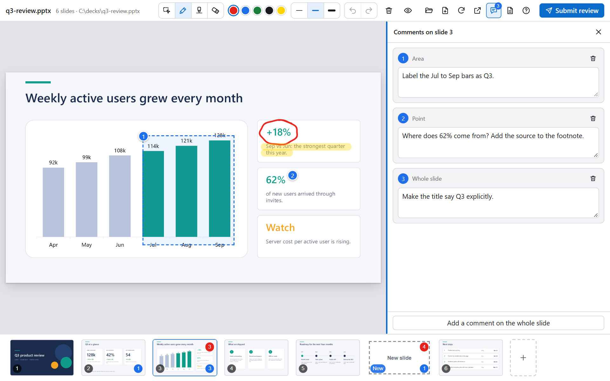
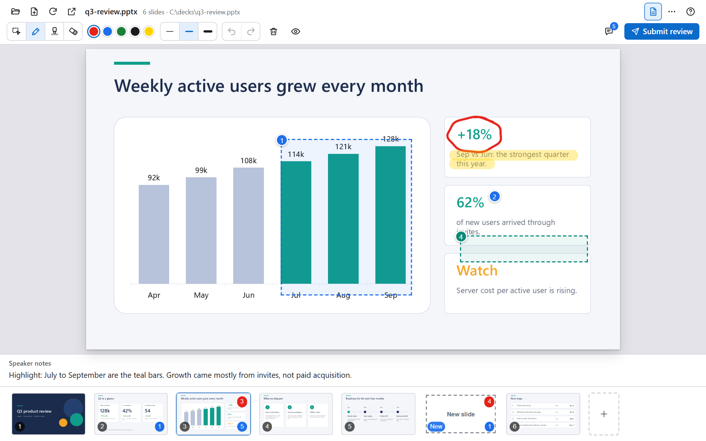

# Using the canvas

[日本語](./ja/usage.md)

Press **?** in the viewer for the in-app help with the same shortcuts.

## Tools and shortcuts

The toolbar has the pen, highlighter and eraser, five colors, three widths, and undo and redo.

| Tool | Key | What it does |
|:--|:--|:--|
| Comment | `C` | Click for a point, drag for an area. A comment on the whole slide is added from the comment list. |
| Pen | `P` | Draws on the slide. |
| Highlighter | `H` | Draws a wide, translucent stroke. |
| Eraser | `E` | Removes strokes. |
| Undo and redo | `Ctrl+Z` `Ctrl+Y` | Undoes marks, comment deletions and slide deletions, latest first. |
| Show or hide marks | `M` | |
| Notes | `N` | Shows the speaker notes. |
| Previous and next slide | `←` `→` | |
| Move the current slide | `Alt+←` `Alt+→` | Rewrites the `.pptx`; a backup is kept. |
| New slide after the current one | `Ctrl+M` | |
| Delete the current slide | `Delete` | Undo with `Ctrl+Z`. |

Clicking the active tool turns it off.

## Comment panel

Drag the left edge of the comment panel to change its width. Double-click the edge to reset it. With the edge focused, `←` `→` change the width (hold `Shift` for bigger steps). The width is remembered.

## Submit your review

Press **Submit review** at the top right. A panel opens with an optional note for anything the marks do not say; `Ctrl+Enter` submits. The button works when the agent has something new to read. What happens next is in [How it works](./how-it-works.md#from-marks-to-changes).

## New slides and sketchbooks

Hover between two slides in the strip and press **+**, or press `Ctrl+M`, to add a blank slide, then sketch the layout. A new slide exists only in the viewer until the agent builds it.

No deck yet? Use **Open a deck** in the top bar, then **Start a sketchbook**, or ask the agent to create a new deck.

## Reorder and delete

Drag slides in the strip to reorder them, or delete one with `Delete` or the **×** that appears on its thumbnail. Only the slide list inside the `.pptx` is rewritten, so nothing is re-saved by PowerPoint, and the previous file is kept as a backup.

> [!TIP]
> Reordering and deleting rewrite the `.pptx`, so close the deck in PowerPoint first. If the deck is generated by a script, change the script too, or the next build brings the old order back.

## Notes

`N` shows the speaker notes under the slide, so you can read them while you review.

## Actions for the agent

| Action | What it does |
|:--|:--|
| `open_deck` | Opens a `.pptx` and waits until it is rendered. |
| `go_to_slide` | Shows a slide. |
| `get_slide` | Reads a slide's title and notes, optionally with its image. |
| `get_outline` | Reads every title with the count of marks and comments, and the new slides. |
| `get_annotations` | Reads marks and comments as data, with numbered images. Marks them as read. |
| `resolve_drafts` | Removes new slides that the agent has turned into real slides. |
| `new_sketchbook` | Starts, or continues, a sketchbook. |
| `move_slide` | Moves a slide (rewrites the file). |
| `new_deck` | Creates a one-slide `.pptx`, blank or from a template, and opens it. |
| `refresh` | Renders the deck again. |

## Language

The canvas starts in English. Open the help (**?**) and choose English or 日本語. The choice is saved and shared by all viewers. To set the first language without opening the page, set the environment variable `PPTX_CANVAS_LANG` to `en` or `ja`; a saved choice takes precedence. The canvas name in the client's list follows the language when the extension starts.
